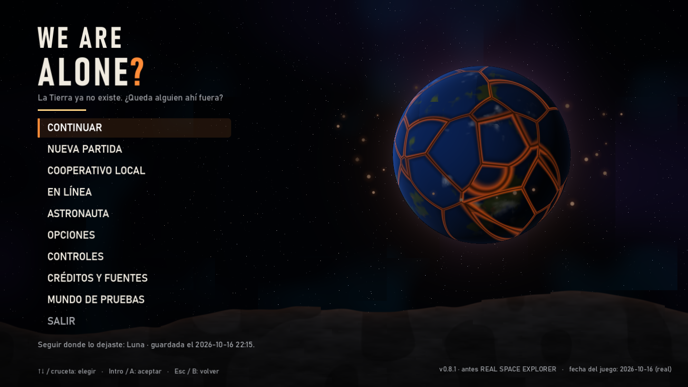
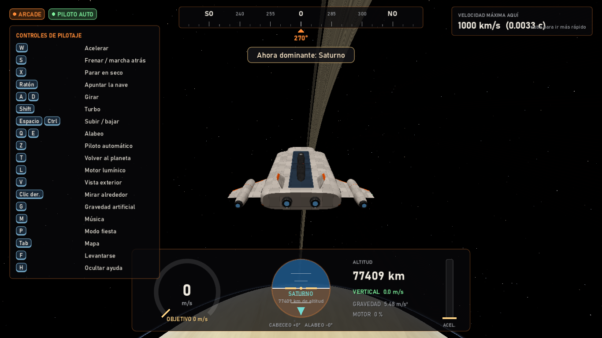
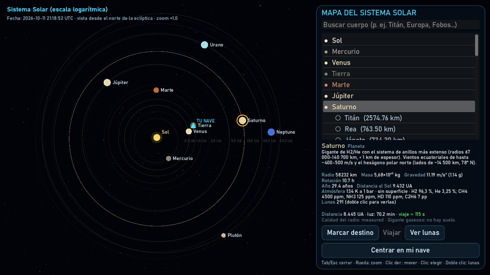
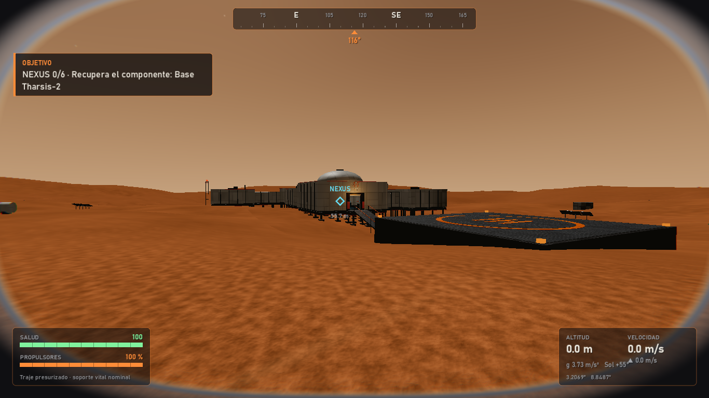
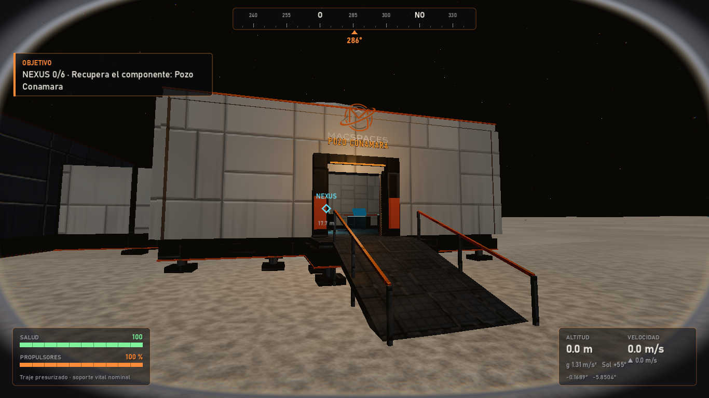
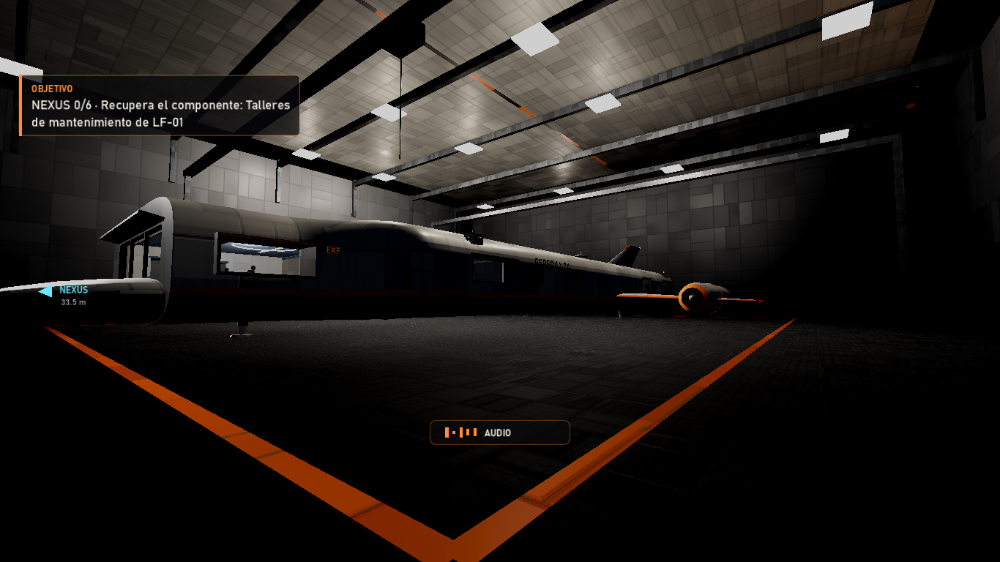
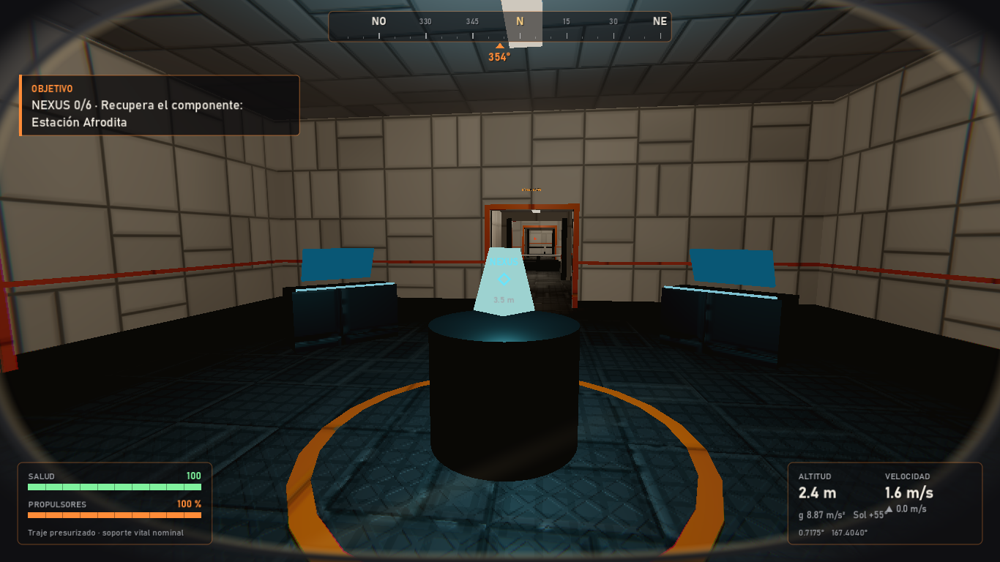
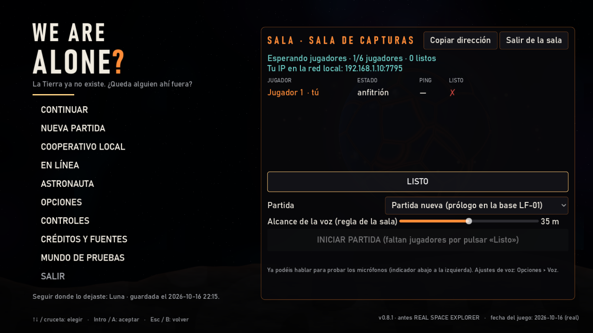
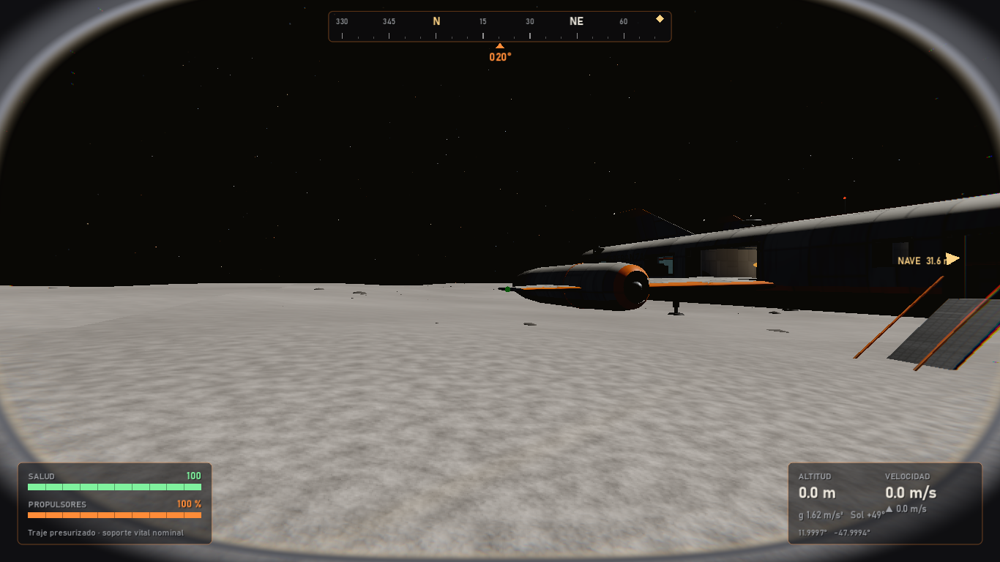

<div align="center">

# 🌌 WE ARE ALONE?

### *La Tierra ya no existe. ¿Queda alguien ahí fuera?*

Exploración espacial **a escala real** · Sistema Solar completo · Cooperativo **en línea hasta 6 jugadores** con chat de voz




</div>

---

## 🚀 ¿De qué va?

Despiertas en una cápsula criogénica de **LF-01**, una base lunar abandonada de la corporación **MacSpaces**. La Tierra
está rota en pedazos incandescentes. Un mensaje grabado de Magnus Blackwell te deja una misión: reunir los seis
componentes del **NEXUS**, repartidos por el Sistema Solar, y averiguar si de verdad estamos solos.

Sin combate, sin árboles de habilidades, sin barras de experiencia. Solo **tú, tu nave y la escala real del espacio**.

<div align="center">


</div>

## ✨ Lo que hay dentro

| | |
|---|---|
| 🪐 **Escala real** | Planetas y lunas con su radio, masa, gravedad, rotación y órbita reales (efemérides en doble precisión). La Luna mide 1.737 km y se camina entera. |
| 🌍 **Terreno procedural** | Planetas esféricos con LOD por quadtree, cráteres, rocas y origen flotante para no perder precisión a millones de km. |
| 🧑‍🚀 **Primera persona de verdad** | Ves tus botas, tus guantes y el borde del casco; andas a saltitos en la Luna como en el Apolo. |
| 🛸 **Tu propia nave** | La *Kestrel*: cabina, comedor, dormitorios, enfermería y sala de máquinas. Pilotaje arcade o simulación, piloto automático, motor lumínico y aterrizaje automático. |
| 🌫️ **Atmósferas** | Desciende por las nubes de Venus, la neblina de Titán o las capas de Júpiter. |
| 🏚️ **Base LF-01** | 22 salas, prólogo con voces y subtítulos, esclusa, hangar con compuertas reales y gravedad artificial. |
| 🧩 **Bases del NEXUS procedurales** | En Mercurio, Venus, Marte, Europa y Titán se genera una base distinta (de 6 a 9 módulos) en el lado de día. |
| 🎙️ **Chat de voz real** | Proximidad 3D, radio por canales con pitidos y estática, y canal de la nave por los altavoces. |
| 🎵 **Música compartida** | Pon tus MP3 en la megafonía de la nave y tus amigos los oyen sincronizados. |
| 🎮 **Cooperativo** | Pantalla dividida local o en línea hasta 6, con el PC de un jugador como anfitrión (sin servidores de pago). |

<div align="center">




</div>

## 🎮 Jugar

### Opción A: el paquete listo (recomendado para amigos)
1. Descarga `WeAreAlone.zip` de la sección **[Releases](../../releases)**.
2. Descomprime y deja juntos `WeAreAlone.exe` y `WeAreAlone.pck`.
3. Abre `WeAreAlone.exe`. Si SmartScreen avisa: *Más información → Ejecutar de todas formas* (no está firmado).

### Opción B: desde el código
1. Descarga **[Godot 4.7.2 estándar](https://godotengine.org/download/archive/)** (no la versión .NET).
2. Clona el repositorio y abre `project.godot` en Godot, o con el ejecutable en la carpeta padre:
   ```powershell
   ..\Godot_v4.7.2-stable_win64.exe --path .
   ```
3. Para generar tu propio paquete: `powershell tools/build.ps1` (sale en `build/WeAreAlone.zip`).

## 🌐 Jugar en línea con amigos



1. **Anfitrión:** *EN LÍNEA → Crear sala*. Acepta el aviso del Firewall marcando redes **privadas y públicas**.
2. Pásale tu dirección a tu amigo (botón **Copiar dirección**).
3. **Amigo:** *EN LÍNEA → Unirse*, pega la dirección.
4. Todos pulsan **LISTO** y el anfitrión, **INICIAR PARTIDA**. Cargáis juntos y empezáis a la vez.

**¿No conecta por Internet?** Si el router no abre el puerto (UPnP) o tu operador usa CGNAT, usad
[Radmin VPN](https://www.radmin-vpn.com/), ZeroTier o Tailscale, o un túnel UDP de [playit.gg](https://playit.gg)
hacia el puerto **7777**. Todos tenéis que usar **la misma versión**: el juego avisa si no.

<br clear="right">

## ⌨️ Controles básicos

| A pie | | En la nave | |
|---|---|---|---|
| `WASD` | Caminar | `W` / `S` | Acelerar / frenar |
| `Mayús` | Correr | `Ratón` | Apuntar |
| `Espacio` | Saltar | `Espacio` / `Ctrl` | Subir / bajar |
| `F` | Interactuar / sentarse | `Z` | Piloto automático |
| `V` | 1ª / 3ª persona | `L` | Motor lumínico |
| `Tab` | Mapa del Sistema Solar | `M` | Música de la nave |
| `Bloq Mayús` | Radio (mantener) | `G` | Gravedad artificial |
| `º` | Canal de la nave | `H` | Ayuda de pilotaje |

También se juega con mando. Todo se puede cambiar en **Opciones**.

## 🛠️ Para desarrolladores

- **Motor:** Godot 4.7.2 · renderizador *Compatibility* (OpenGL), pensado para funcionar en una Intel HD 630.
- **Código:** GDScript con tipos estáticos, todo en español. Arquitectura y decisiones en
  [`docs/ARCHITECTURE_DECISIONS.md`](docs/ARCHITECTURE_DECISIONS.md) (más de 45 ADR) y reglas del proyecto en
  [`CLAUDE.md`](CLAUDE.md).
- **Pruebas** (ejecutables sin ventana):
  ```powershell
  ..\Godot_v4.7.2-stable_win64.exe --headless --path . -- --run-tests                 # unitarias
  ..\Godot_v4.7.2-stable_win64.exe --headless --fixed-fps 60 --path . -- --smoke-test  # integración
  ..\Godot_v4.7.2-stable_win64.exe --headless --fixed-fps 60 --path . -- --nexus-smoke # bases del NEXUS
  powershell tools/net_smoke.ps1                                                       # red: 3 jugadores
  ```
- **Datos físicos:** los cuerpos se generan con `tools/gen_bodies.py`; cada dato lleva su calidad y su fuente.
  El terreno de los cuerpos reales es procedural y lo declara.
- **Documentación:** [`docs/MILESTONES.md`](docs/MILESTONES.md) (hitos), [`docs/KNOWN_LIMITATIONS.md`](docs/KNOWN_LIMITATIONS.md)
  (limitaciones conocidas) y [`docs/PERFORMANCE.md`](docs/PERFORMANCE.md) (mediciones).

## 🎧 Créditos de audio

- Banda sonora propia y efectos sintetizados con `tools/gen_audio.py` (CC0).
- Efectos grabados de [Kenney](https://www.kenney.nl) (CC0).
- Música CC0 de [OpenGameArt](https://opengameart.org): *Dark Sci-Fi Audio Pack* de **SRG774**, *Outer Space Loop*
  de **wipics** y *Starfield Romance* de **Yoiyami**.
- Detalle completo en [`assets/audio/CREDITOS.md`](assets/audio/CREDITOS.md).

<div align="center">

---



**Hecho con 🧡 y mucha física real.** ¿Estamos solos? Ve a comprobarlo.

</div>
